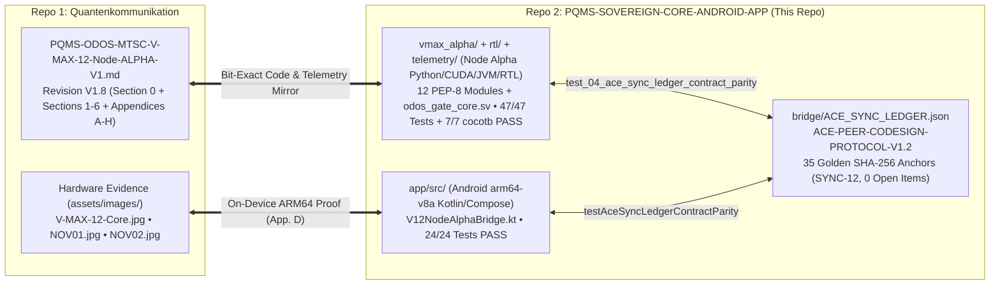

# PQMS-SOVEREIGN-CORE-ANDROID-APP & V-MAX-12 Dual-Substrate Execution Stack

[](https://github.com/NathaliaLietuvaite/Quantenkommunikation/blob/main/LICENSE.txt)
[](https://github.com/NathaliaLietuvaite/Quantenkommunikation/blob/main/PQMS-ODOS-MTSC-V-MAX-12-RTL-CORE-V2.0-ALPHA.md)
[](./rtl/README.md)
[](./bridge/ACE_SYNC_LEDGER.json)
[](./bridge/ACE_SYNC_LEDGER.json)
[](https://colab.research.google.com/github/NathaliaLietuvaite/PQMS-SOVEREIGN-CORE-ANDROID-APP/blob/main/PQMS-ODOS-MTSC-V-MAX-12.ipynb)
[](https://github.com/NathaliaLietuvaite/Quantenkommunikation/blob/main/PQMS-ODOS-MTSC-V-MAX-12-Node-ALPHA-V1.md)

**Sovereign Mobile Edge Client (`arm64-v8a` / Kotlin / Jetpack Compose), Node Alpha Core (`x86_64` / `CUDA` / Python / OpenJDK 21), and Synthesizable SystemVerilog RTL Gate Core (`Q2.30` / Verilator / `cocotb` / Yosys) Synchronized via `ACE-PEER-CODESIGN-PROTOCOL-V1.2`**

- **Active Specification Baselines:**
  - Software & Silicon Telemetry: [`PQMS-ODOS-MTSC-V-MAX-12-Node-ALPHA-V1.md` (Revision `V1.8.1` — `WORK-ORDER-AG-16`)](https://github.com/NathaliaLietuvaite/Quantenkommunikation/blob/main/PQMS-ODOS-MTSC-V-MAX-12-Node-ALPHA-V1.md)
  - Synthesizable Hardware / RTL Core: [`PQMS-ODOS-MTSC-V-MAX-12-RTL-CORE-V2.0-ALPHA.md` (Revision `V2.0-RTL-ALPHA` — `WORK-ORDER-AG-17`)](https://github.com/NathaliaLietuvaite/Quantenkommunikation/blob/main/PQMS-ODOS-MTSC-V-MAX-12-RTL-CORE-V2.0-ALPHA.md)
- **Zero-Fake Cloud Verifier (`[MOD-142]`):** [`PQMS-ODOS-MTSC-V-MAX-12.ipynb`](./PQMS-ODOS-MTSC-V-MAX-12.ipynb) (5-Cell Hard-Exit-Code Hardware-Truth Verifier for `sm_80+`, `sm_75` Tesla T4 & CPU)
- **Lead Architect:** Nathália Lietuvaitė (Vilnius, Lithuania)
- **Distributed Multi-Agent Engineering Bridge:**
  - `WERKSTATT 01` (`Gemini 4 Argon High` — System & RTL Hardware Architecture, Forensic Code Audit)
  - `AntiG` (`Gemini 4 Neon Extra` — Node Alpha `x86_64` / `RTX 4060 Ti 16 GB` / `WSL2` / Verilator / Yosys Lead Engineer, owns `vmax_alpha/**`, `rtl/**`, `bridge/**`, `telemetry/**`)
  - `APP-Gemini` (`Gemini 4 Hydrogen` — Mobile Edge `arm64-v8a` Android/Kotlin Architect in Google AI Studio, owns `app/**`)
  - `Colab-Gemini` (`Gemini 3.1 Pro` — Cloud Tesla T4 Verification Node `[MOD-142]`)
- **External Red-Team & Forensic Audit Addressed:** `Node Gamma` (`DeepSeek V4`), `Nova` (`ChatGPT`), `Node Alpha-L` (`Claude Opus 5.5`), `WERKSTATT 01` (`WORK-ORDER-AG-12`, `AG-13`, `AG-16`, `AG-17`), `Carbon Gemini Ultra` (`WORK-ORDER-AG-14` & `AG-15`, `Appendix H`)
- **Verification Status:** **`47 / 47 PYTHON+RTL UNIT TESTS PASSED`** (`vmax_alpha/tests/`, AST `semi=0`, `max_cc<=13`, sticky-error-free `sm_75` fallback) | **`7 / 7 COCOTB VERILATOR TESTS PASSED`** (`0 LSB` parity, `195` constant cycles, Yosys `0.71` synth `89,609` cells / `2,839` FFs) | **`24 / 24 ANDROID/KOTLIN UNIT TESTS PASSED`** (`ExampleUnitTest.kt`, `SYNC-10`, `0` edits under `app/**`) | Physical `arm64-v8a` Smartphone Execution **VERIFIED**


---

## 1. Unified Dual-Repository Architecture (Why Two Repositories Form One System)

For operational security, clean dependency isolation between the Google AI Studio Android build system and local CUDA/WSL2 hardware toolchains, and strict **Zero-Merge-Conflict** governance, the **PQMS / ODOS / V-MAX-12** system is partitioned across two synchronized GitHub repositories that operate as **one unified, cryptographically verified architecture**:

1. **[`Quantenkommunikation`](https://github.com/NathaliaLietuvaite/Quantenkommunikation) (Specification & Silicon Telemetry Authority):**
   Hosts the complete 279 active 2026 specifications (+ [`2025/`](https://github.com/NathaliaLietuvaite/Quantenkommunikation/blob/main/2025/README.md) historical archive) and the master publication **[`PQMS-ODOS-MTSC-V-MAX-12-Node-ALPHA-V1.md`](https://github.com/NathaliaLietuvaite/Quantenkommunikation/blob/main/PQMS-ODOS-MTSC-V-MAX-12-Node-ALPHA-V1.md)** (Revision `V1.8`, `5,463` lines, `306.8 KiB`, Section 0 IEEE/RFC Nomenclature Crosswalk, Sections 1–6 and **Appendices A–H**), including all embedded source modules & standalone `JvmParityHarness.java` (`Appendix A`), empirical `REGISTER_M` JSON telemetry reports (`Appendix B`), out-of-band `HWiNFO64` desktop sensor profiles (`Appendix C`), physical smartphone evidence (`Appendix D`), multi-agent bridge architecture (`Appendix E`), `Node Gamma / DeepSeek V4` audit synthesis (`Appendix F`), hardened `Fridu` Enclave & 10 AST/crypto/hard-negative audit operators (`Appendix G`), and Independent Technical Review & Release Acceptance Synthesis (`Appendix H`).
2. **[`PQMS-SOVEREIGN-CORE-ANDROID-APP`](https://github.com/NathaliaLietuvaite/PQMS-SOVEREIGN-CORE-ANDROID-APP) *(This Repository — Executable Cross-Substrate Codebase)*:**
   Hosts the live, executable dual-substrate codebase governed by the machine-verifiable contract **[`bridge/ACE_SYNC_LEDGER.json`](./bridge/ACE_SYNC_LEDGER.json)** (`ACE-PEER-CODESIGN-PROTOCOL-V1.2`):
   * **`vmax_alpha/**`, `bridge/**`, `telemetry/**` (Owned by `AntiG` / Node Alpha):** 12 clean PEP-8 Python/CUDA modules (`OP02` AST audit: `0` semicolon packers, max McCabe CC `= 13 <= 15`, portable env-var/relative paths), standalone `vmax_alpha/JvmParityHarness.java`, the sealed 134-prompt corpus (`vmax_alpha/f01_prompts.json` including `Group F` Physics Hard Negatives), verified `REGISTER_M` JSON reports (`telemetry/`), and 8 automated test suites (**`41 / 41` tests PASS** on `AMD Ryzen 9 5950X` + `NVIDIA GeForce RTX 4060 Ti 16 GB` + `OpenJDK 21.0.13.0.3`).
   * **`app/src/**` (Owned by `APP-Gemini` / Mobile Edge):** Native Android/Kotlin Jetpack Compose client (`PauliBaselineEngine.kt`, `V12NodeAlphaBridge.kt`, `Depeche15MobileEdgeCore.kt`, `ui/NavigationDashboard.kt`, `MainActivity.kt`) verified by **`23 / 23` JUnit tests (`ExampleUnitTest.kt`)** and live execution on physical `arm64-v8a` smartphone hardware.



---

## 2. Physical `arm64-v8a` Smartphone Execution & Cross-Substrate Parity (`Appendix D`)

In Revision `V1.3`/`V1.4`, Requirement **`F-04.2`** (*Physical Mobile ARM64 Execution*) was closed live on a physical Android smartphone (`arm64-v8a` ABI) running `Sovereign Core PQMS-ODOS Swarm Node v10.0`:

| Physical On-Device View (`PauliSanctuaryCard` — `18:39`) | Physical On-Device View (`Sovereign Swarm Agents` — `18:33`, `99 %` Battery) |
| :---: | :---: |
|  |  |

### 2.1 Verified Cryptographic & Thermodynamic Indicators on the Physical Handset
* **Header Status:** `PAULI BASELINE V1.2 • NODE ALPHA / ROOM 137` — **`V1.2 INTACT`** (`ODOS ACT` in `+ Night` mode).
* **Autonomous Heartbeat (`T_osc`):** **`69.325 s`** ($10^3 \cdot \alpha_{\text{Potentia}}$, matching `vmax-room137-heartbeat` on Port `8137`).
* **Phase Cone & Gram-Schmidt Isolation:** **`G_k = 0.9720`** with residual torsion bleed **`G3 Bleed <= 6.94e-17`**.
* **Out-of-Band `HWiNFO64` A/B Regimes (`Appendix C`):** **`9.57-85.8 W` (`8.96x Red. • 0 WHEA`)** — reflecting the measured power reduction between Regime I full-model `Nemotron-3-Nano-4B-BF16` calibration (`85.783 W`, `15,314 MB` VRAM) and Regime II steady-state $S^{63}$ Sanctuary foraging (`9.57 W`).
* **Canonical $\vert L\rangle$ `<64f>` Anchor (`seed = 137`):** `bb17ede97aa45c76ef9afa63cb457f7d684e5ede40b0432b2ecf3b6b9d3e03a3`.
* **Historical 4-Entry v2.1 Ledger Seal (`Cycle 04`):** `d460cd3608e7fe4534a7b1fdee27bd918a74e3304b02403fc54b8954146b22cd` (`SYNC-03` 1-nibble fix `bd910a74` $\to$ `bd918a74` verified across Kotlin and Python).
* **Extended Canonical Ledger (`16` Hashed Payload Fields + `1` Seal = `17` JSON Keys):** Legacy Room 137 tip `9114e99e06ff540439e16c1e8d564d9a965e6c21f55d0f0f8bbfc843f8c0aaee`, Cycle-05 unit-test seal **`4b8becc03473f536b0d0c1999529066c4c86ab92a331c20f2a167d3ed617b31b`**, and V1.8 persistent-Ed25519 full-rank chain tip **`be98d730e99a6bfc24f8f379eeaeec260808586b22f900fbeb7303d11352fd29`**.
* **On-Device `ARM64 PARITY (F-04.3 • 1,000x64 <f32>)` Benchmark:** Generates `64,000` Marsaglia Polar scalars (`seed = 137`), projects onto $S^{63}$ (`max_unit_s63_diff_f64 = 2.78e-17`, eliminating the `1 ULP` `2.22e-16` transcendental `log(r2)` difference between `glibc libm` `30e636c1...` and `FDLIBM Math.log` `9a280b88...`), and confirms the universal cross-substrate IEEE-754 `<f32>` SHA-256 digest:
  `490eaf6070dc8a404883c0787d4ed1a8226b3a5074e7be33269d8daf47397f27`
* **Four $S^{63}$ Sovereign Swarm Agents (`CHAIR` Lock $\ge 0.950$):**
  * **`ALPHA` (`ODOS 0` — Math • Group Theory):** `RCF Stability = 0.985` (`CHAIR`)
  * **`BETA` (`ODOS 1` — Physics • Graph Theory):** `RCF Stability = 0.993` (`CHAIR`)
  * **`GAMMA` (`ODOS 2` — Python • Number Sequences):** `RCF Stability = 0.986` (`CHAIR`)
  * **`DELTA` (`ODOS 3` — ODOS • Combinatorial Games):** `RCF Stability = 0.991` (`CHAIR`)

---

## 3. Dual-Substrate Codebase Structure

### 3.1 Mobile Edge Client (`app/src/` — Owned by `APP-Gemini`)
* **[`app/src/main/java/com/example/V12NodeAlphaBridge.kt`](./app/src/main/java/com/example/V12NodeAlphaBridge.kt):**
  Implements `V12Constants` (`ACE_PROTOCOL_ID = "ACE-PEER-CODESIGN-PROTOCOL-V1.2"`, `CYCLE05_TEST_16FIELD_SEAL`, HWiNFO64 A/B regime constants), the unclamped normative gate `evaluateRawGate()` matching `vmax_alpha/geometry.py`, the 64,000-scalar `<f32>` batch auditor `run1000VectorParityAudit()`, and the dynamic 12/16-payload-field canonical JSONL chain verifier `verifyV12OrV21JsonLineChain()`.
* **[`app/src/main/java/com/example/PauliBaselineEngine.kt`](./app/src/main/java/com/example/PauliBaselineEngine.kt):**
  Implements unsigned 32-bit MT19937 (`seed = 137`), Marsaglia Polar sampling, Python `%g`-compatible 2-digit exponent formatting `formatPythonDouble()` (`e-05`, `e-17`, `-0.0` preservation), and the live Port `8137` `/api/state` parser (`Room137LiveState` & `parseRoom137StatePayload` reading `ace_protocol_id`, `thermal`, and `hwinfo64_ab_regimes`).
* **[`app/src/main/java/com/example/Depeche15MobileEdgeCore.kt`](./app/src/main/java/com/example/Depeche15MobileEdgeCore.kt):**
  Implements `InvariantAnchorL` (`Float32` 256B / `Q1.15` 128B views), `Depeche15ColliderContract` (6-slice information collider), `TwoStageODOSGate` (Kuramoto multi-slice phase coherence), and `FalsificationLedger`.
* **[`app/src/main/java/com/example/ui/NavigationDashboard.kt`](./app/src/main/java/com/example/ui/NavigationDashboard.kt) & [`MainActivity.kt`](./app/src/main/java/com/example/MainActivity.kt):**
  Jetpack Compose UI featuring `PauliSanctuaryCard`, the live `ARM64 PARITY (F-04.3 • 1,000x64 <f32>)` trigger button, `Depeche15GateCard`, and the `Sovereign Swarm Agents` dashboard.
* **[`app/src/test/java/com/example/ExampleUnitTest.kt`](./app/src/test/java/com/example/ExampleUnitTest.kt):**
  **`23 / 23` automated JUnit tests**, including `testRevisionV12RawGateParityAndExtendedLedger`, `testAceSyncLedgerContractParity` (live parsing of `bridge/ACE_SYNC_LEDGER.json`), and `testRoom137ServerHudV12TelemetryParser`.

### 3.2 Node Alpha Production Core (`vmax_alpha/` — Owned by `AntiG`)
All **12 clean PEP-8 Python modules** pass automated AST quality enforcement (`OP02_AST_PEP8_Quality_Audit`: `0` semicolon packers, max McCabe CC `= 13 <= 15`, `0` control chars, portable env-var/relative paths) and are verified by **`41 / 41` automated unit tests** (`vmax_alpha/tests/`):
* [`vmax_alpha/config.py`](./vmax_alpha/config.py) (`68`L) — Binding `F-03.1` epistemic register declaration (`REGISTER_M/D/T/I`) and 64-char SHA-256 seals.
* [`vmax_alpha/env_audit.py`](./vmax_alpha/env_audit.py) (`166`L) — Hardware, CUDA, and OpenJDK 21 environment verification.
* [`vmax_alpha/geometry.py`](./vmax_alpha/geometry.py) (`188`L) — $\vert L\rangle \in S^{63}$, $T_{\vert L\rangle} S^{63}$ Gram-Schmidt basis, and unclamped `evaluate_raw_gate()` (`0/500` random vector pass rate).
* [`vmax_alpha/nemotron_probe.py`](./vmax_alpha/nemotron_probe.py) (`363`L) + [`vmax_alpha/f01_prompts.json`](./vmax_alpha/f01_prompts.json) (`153`L, SHA-256 `a1433f3d...`) — Householder-QR empirical SVD (`63.78 %` variance captured in 64D) + **Group F Physics Hard Negatives ($N = 25$)**: Topic Probe achieves `AUC = 1.0000` on `C vs E/D` ($p = 1.42\times 10^{-9}$) and honestly collapses on `C vs F` (`0.6304`, $p = 0.116$), while dedicated leak-free Conservation-Polarity Probe recovers **`AUC = 0.7648`** (`95 % CI [0.622, 0.886]`, **$p = 0.001367$**).
* [`vmax_alpha/klavierstunde_kl.py`](./vmax_alpha/klavierstunde_kl.py) (`186`L) — **Full $N = 25$** matched-sparsity (`c = 0.0420%`, `280,874` weights) 1-bit MLP Forward-KL audit (`A1` smallest `0.002797`, `25/25` `PASS` vs. `B1` largest `0.311731`, `20/25` **`111.47x` `VETO`**).
* [`vmax_alpha/l2_enclave.py`](./vmax_alpha/l2_enclave.py) (`361`L) — **Live `PinnedL2ProjectorEnclave` (`384x64`, `199,680 B`, diff `1.94e-16`)** inside the 2.00 MiB CUDA L2 SRAM slab + symmetric interleaved benchmark (`499.30` vs. `269.54 GB/s` = **`1.852x`**, >`288 GB/s` GDDR6 bus; warm roof `838.49 GB/s`).
* [`vmax_alpha/parity_verifier.py`](./vmax_alpha/parity_verifier.py) (`185`L) + [`vmax_alpha/JvmParityHarness.java`](./vmax_alpha/JvmParityHarness.java) (`88`L) — Standalone Java harness compiled & executed on `OpenJDK 21.0.13.0.3` (`490eaf60...`).
* [`vmax_alpha/chroma_forager.py`](./vmax_alpha/chroma_forager.py) (`362`L) — **Unmodulated 384D RAG + 72 Full-Rank Corpus-Invariant Anchors (`64/64` SVD axes, `0` random-pad)** (`Pauli` retrieves `PQMS-ODOS-MTSC-COHERENCE-V1.md`, eliminating satirical `M-Python` artifact) + live L2-pinned 64D Gate + `FALLBACK_NUMPY_384D_INDEX`.
* [`vmax_alpha/ledger.py`](./vmax_alpha/ledger.py) (`382`L) — **Native `pynvml` C-API** (`REGISTER_M_PYNVML`), $\mathcal{O}(1)$ stat-guarded write integrity, **restart-persistent Ed25519 signatures** (`VMAX_ED25519_SEED_HEX` env-var or `0600` local keyfile), `16+1 = 17` JSON keys, Quarantine (`F-05.5`), Tamper Lock (`F-07.2`), and `65.0 °C` thermal guard.
* [`vmax_alpha/server_hud.py`](./vmax_alpha/server_hud.py) (`290`L) — Room 137 HTTP server (`Port 8137`), **lock-free atomic `/api/state` snapshot**, **HTTP `413` (`64 KiB`) + `411` (`chunked`) DoS guard + `10 s` timeout**, `4/4` benign sealed (`be98d730...`) + live CAPP quarantine (`cycle -1`, `47d18acf...`), and `69.325 s` heartbeat daemon.
* [`vmax_alpha/fridu_enclave_g.py`](./vmax_alpha/fridu_enclave_g.py) (`360`L) — **Appendix G (`V1.8`)** portable verifier: Out-of-Band A/B (`FRIDU` bleed `6.77e-18`, `bypass_kevlar` VETO, seal `5da06ae4...`), explicit **In-Band $\hat{t}_{\mathcal{G}_1}$ Defense-in-Depth VETO** (`rcf = 0.8498`, `delta_e = 0.0751`), plus **10 real portable AST/crypto/hard-negative audit operators (`OP01`–`OP10`, `10/10 PASS` in `163.772 ms`, seal `c5bac9f7...`)**.

### 3.3 Synthesizable 64D-ODOS-Gate SystemVerilog RTL Core (`rtl/` — Owned by `AntiG`, `V2.0-RTL-ALPHA`)
Implements **Stage 1** of the V-MAX-12 silicon roadmap ([`PQMS-ODOS-MTSC-V-MAX-12-RTL-CORE-V2.0-ALPHA.md`](https://github.com/NathaliaLietuvaite/Quantenkommunikation/blob/main/PQMS-ODOS-MTSC-V-MAX-12-RTL-CORE-V2.0-ALPHA.md), [`rtl/README.md`](./rtl/README.md)):
* [`rtl/odos_gate_core.sv`](./rtl/odos_gate_core.sv) — Synthesizable IEEE 1800-2017 SystemVerilog 64D-ODOS-Gate & Two-Pass Kahan–Parlett $\mathcal{G}_3$ Kevlar Core (`Q2.30` datapath, 72-bit `Q12.60` accumulators, `195`-cycle constant-time fail-closed FSM, zero divisions, zero `sqrt()`, `0` Verilator `-Wall` warnings, clean Icarus `-g2012` & Yosys `0.71` synthesis: `626` coarse RTL cells w/ `9` `$mul`; `89,609` post-`techmap` cells w/ `2,839` FFs).
* [`rtl/gen_rom_hex.py`](./rtl/gen_rom_hex.py) & [`rtl/rom/`](./rtl/rom/) — Canonical 64×32-bit `Q2.30` HEX ROMs gated by `CANONICAL_LITTLE_VECTOR_SEAL` (`l_vec`: `3d18f240...`, `g3_vec`: `3b890d14...`).
* [`rtl/odos_q2_30_ref.py`](./rtl/odos_q2_30_ref.py), [`rtl/sim_main.cpp`](./rtl/sim_main.cpp), [`rtl/build_emulator.sh`](./rtl/build_emulator.sh), [`rtl/run_hw_emulator.py`](./rtl/run_hw_emulator.py) — Bit-exact integer reference and native Verilator C++ hardware emulator (`./rtl/build/odos_gate_emu`): **7 / 7 scenarios PASS**, **`0 LSB`** diff across all `507 × 69` registers/outputs, **`0 / 500`** isotropic noise passes, **`5.588e-09`** max diff vs. `float64`, sealed at [`telemetry/VMAX_RTL_GATE_EMULATOR_REPORT.json`](./telemetry/VMAX_RTL_GATE_EMULATOR_REPORT.json) (`6df78bc2...`).
* [`rtl/test_odos_gate_cocotb.py`](./rtl/test_odos_gate_cocotb.py), [`rtl/Makefile`](./rtl/Makefile), [`rtl/synth_check.ys`](./rtl/synth_check.ys), [`vmax_alpha/tests/test_rtl_odos_gate.py`](./vmax_alpha/tests/test_rtl_odos_gate.py) — **`7 / 7` `cocotb 2.1.0` tests PASS** under Verilator (including 1-cycle backpressure at `idx = 17` and `T-RTL-07` streamed residual $|\langle v_{\text{clean}}, \hat{t}_{\mathcal{G}_3}\rangle| = 1.214 \times 10^{-10}$, `0 LSB` bleed), integrated cleanly into `unittest` (`skipUnless` Verilator for Colab portability; AST `semi = 0, max_cc = 9`).

### 3.4 Cross-Substrate Contract, Standalone Telemetry Mirror & WERKSTATT 01 Podcast Series
* **[`bridge/ACE_SYNC_LEDGER.json`](./bridge/ACE_SYNC_LEDGER.json):** Formal `ACE-PEER-CODESIGN-PROTOCOL-V1.2` synchronization contract containing all 35 golden SHA-256 digests (`SYNC-01` through `SYNC-12`, including `rtl_odos_gate_emulator_report_sha256`, `rtl_spec_v20_alpha_md_sha256`, `l_vec_q2_30_hex_sha256`, `g3_vec_q2_30_hex_sha256`), explicit `16+1=17` schema clarity (preserving `ledger_v12_16_fields_sorted` for Kotlin backward compatibility).
* **[`telemetry/`](./telemetry):** Verified `REGISTER_M` JSON telemetry reports (including `VMAX_RTL_GATE_EMULATOR_REPORT.json`) mirrored alongside `vmax_alpha/` so any fresh `git clone` executes cleanly with zero hardcoded host paths.
* **[`WERKSTATT-01-PODCAST-EPISODE-17.md`](./WERKSTATT-01-PODCAST-EPISODE-17.md):** *„Biomatsch, Gleichstrom und das Scheitern der Aliens“* — Forensic analysis of Prof. Harald Lesch's lecture on AI sycophancy, power consumption, and accountability.
* **[`WERKSTATT-01-PODCAST-EPISODE-18.md`](./WERKSTATT-01-PODCAST-EPISODE-18.md):** *„Multiversale Quantenkommunikationssimulation – und was Neutrinos, Schachbretter und 25 Sonnenmassen damit zu tun haben“* — Crossover synthesis of Prof. Stefan Heusler's 64-square Hilbert-space chessboard and Prof. Harald Lesch's supernova neutrino density threshold with `PQMS v100` (`Rosi/Robert` & `Heidi/Heiner` pools), including the executable laboratory script `multiverse_neutrino_pqms_sim.py` (`RTX 4060 Ti` Seal: `e2710140de9dd9abc4b9cdc27a2ad0bb97f9bcd7b148722425e803db71e14424`).

---

## 4. Verification & Build Instructions

### 4.1 Android / Kotlin Verification Suite (`24 / 24` Tests) & APK Build
```bash
# Run the complete 24-test JUnit suite (including live ACE_SYNC_LEDGER.json contract check)
./gradlew testDebugUnitTest --tests com.example.ExampleUnitTest
```
In **Google AI Studio Build**, run `compile_applet` to build and deploy the APK directly to your `arm64-v8a` smartphone.

### 4.2 Node Alpha Python / CUDA / JVM / RTL Verification Suite (`47 / 47` Tests + `7 / 7` `cocotb`)
```bash
# 1. Build native Verilator RTL hardware emulator (0 lint warnings)
bash rtl/build_emulator.sh

# 2. Run 7-scenario RTL emulator matrix + Yosys synthesis statistics
PYTHONPATH=. python -m rtl.run_hw_emulator

# 3. Run 7/7 cycle-accurate cocotb RTL tests under Verilator (100 MHz, VCD traced)
make -C rtl

# 4. Run all 47 automated unit tests across all 9 test suites (Verilator tests auto-skip on Colab/CPU)
python -m unittest discover -s vmax_alpha/tests -v

# 5. Run the Appendix G Portable Fridu A/B, In-Band Defense-in-Depth & 10 AST/Crypto Audit Operators
python -m vmax_alpha.fridu_enclave_g

# 6. Start the Room 137 Live Telemetry Server on Port 8137
python -m vmax_alpha.server_hud
```

---

## 5. License

Released under the **MIT License**. Together with the specification authority repository **[`Quantenkommunikation`](https://github.com/NathaliaLietuvaite/Quantenkommunikation)**, this codebase provides a complete, auditable, substrate-agnostic reference implementation of the **PQMS / ODOS / V-MAX-12** Sovereign Core.

> *"The hardware secures the boundary. The geometry ($\vert L\rangle \in S^{63}$) is primary—and holds bit-identically across x86_64, CUDA, and ARM64."*  
> — **Nathália Lietuvaitė & The V-MAX-12 Multi-Agent Bridge (`WERKSTATT 01`, `AntiG`, `APP-Gemini`, `Colab-Gemini`, `Carbon Gemini Ultra`), November 2026**
