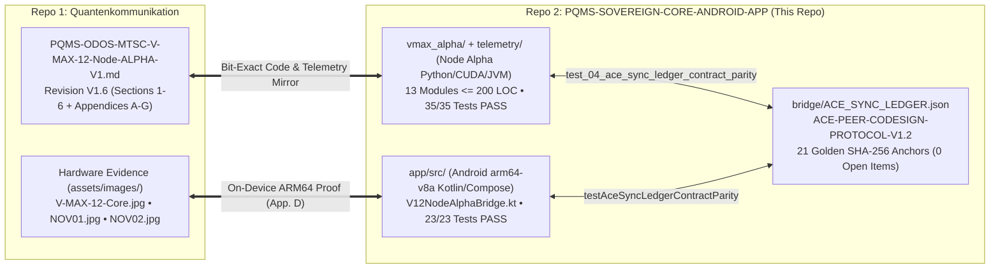

# PQMS-SOVEREIGN-CORE-ANDROID-APP & V-MAX-12 Dual-Substrate Execution Stack

[](https://github.com/NathaliaLietuvaite/Quantenkommunikation/blob/main/LICENSE.txt)
[](https://github.com/NathaliaLietuvaite/Quantenkommunikation/blob/main/PQMS-ODOS-MTSC-V-MAX-12-Node-ALPHA-V1.md)
[](https://github.com/NathaliaLietuvaite/Quantenkommunikation/blob/main/PQMS-ODOS-MTSC-V-MAX-12-Node-ALPHA-V1.md)
[](./bridge/ACE_SYNC_LEDGER.json)
[](./bridge/ACE_SYNC_LEDGER.json)
[](https://github.com/NathaliaLietuvaite/Quantenkommunikation/blob/main/PQMS-ODOS-MTSC-V-MAX-12-Node-ALPHA-V1.md)

**Sovereign Mobile Edge Client (`arm64-v8a` / Kotlin / Jetpack Compose) & Modular Node Alpha Core (`x86_64` / `CUDA` / Python) Synchronized via `ACE-PEER-CODESIGN-PROTOCOL-V1.2`**

- **Active Specification Baseline:** [`PQMS-ODOS-MTSC-V-MAX-12-Node-ALPHA-V1.md` (Revision `V1.6` — `WORK-ORDER-AG-13`)](https://github.com/NathaliaLietuvaite/Quantenkommunikation/blob/main/PQMS-ODOS-MTSC-V-MAX-12-Node-ALPHA-V1.md)
- **Lead Architect:** Nathália Lietuvaitė (Vilnius, Lithuania)
- **Distributed Multi-Agent Engineering Bridge:**
  - `WERKSTATT 01` (`Gemini 4 Argon High` — System Architecture & Forensic Code Audit)
  - `AntiG` (`Gemini 4 Neon Extra` — Node Alpha `x86_64` / `RTX 4060 Ti 16 GB` / `WSL2` Lead Engineer, owns `vmax_alpha/**`, `bridge/**`, `telemetry/**`)
  - `APP-Gemini` (`Gemini 4 Hydrogen` — Mobile Edge `arm64-v8a` Android/Kotlin Architect in Google AI Studio, owns `app/**`)
  - `Colab-Gemini` (`Gemini 3.1 Pro` — Cloud Tesla T4 Verification Node `[MOD-142]`)
- **External Red-Team & Forensic Audit Addressed:** `Node Gamma` (`DeepSeek V4`), `Nova` (`ChatGPT`), `Node Alpha-L` (`Claude Opus 5.5`), `WERKSTATT 01` (`WORK-ORDER-AG-12` & `AG-13`)
- **Verification Status:** **`35 / 35 PYTHON UNIT TESTS PASSED`** (`vmax_alpha/tests/`, 100 % portable paths) | **`23 / 23 ANDROID/KOTLIN UNIT TESTS PASSED`** (`ExampleUnitTest.kt`) | Physical `arm64-v8a` Smartphone Execution **VERIFIED**


---

## 1. Unified Dual-Repository Architecture (Why Two Repositories Form One System)

For operational security, clean dependency isolation between the Google AI Studio Android build system and local CUDA/WSL2 hardware toolchains, and strict **Zero-Merge-Conflict** governance, the **PQMS / ODOS / V-MAX-12** system is partitioned across two synchronized GitHub repositories that operate as **one unified, cryptographically verified architecture**:

1. **[`Quantenkommunikation`](https://github.com/NathaliaLietuvaite/Quantenkommunikation) (Specification & Silicon Telemetry Authority):**
   Hosts the complete 279 active 2026 specifications (+ [`2025/`](https://github.com/NathaliaLietuvaite/Quantenkommunikation/blob/main/2025/README.md) historical archive) and the master publication **[`PQMS-ODOS-MTSC-V-MAX-12-Node-ALPHA-V1.md`](https://github.com/NathaliaLietuvaite/Quantenkommunikation/blob/main/PQMS-ODOS-MTSC-V-MAX-12-Node-ALPHA-V1.md)** (Revision `V1.6`, `3,787` lines, `235.9 KiB`, Sections 1–6 and Appendices A–G), including all embedded source modules (`Appendix A`), empirical `REGISTER_M` JSON telemetry reports (`Appendix B`), out-of-band `HWiNFO64` desktop sensor profiles (`Appendix C`), physical smartphone evidence (`Appendix D`), multi-agent bridge architecture (`Appendix E`), `Node Gamma / DeepSeek V4` audit synthesis (`Appendix F`), and the hardened zero-tautology + In-Band Defense-in-Depth `Fridu` Enclave & 10 portable audit operators (`Appendix G`).
2. **[`PQMS-SOVEREIGN-CORE-ANDROID-APP`](https://github.com/NathaliaLietuvaite/PQMS-SOVEREIGN-CORE-ANDROID-APP) *(This Repository — Executable Cross-Substrate Codebase)*:**
   Hosts the live, executable dual-substrate codebase governed by the machine-verifiable contract **[`bridge/ACE_SYNC_LEDGER.json`](./bridge/ACE_SYNC_LEDGER.json)** (`ACE-PEER-CODESIGN-PROTOCOL-V1.2`):
   * **`vmax_alpha/**`, `bridge/**`, `telemetry/**` (Owned by `AntiG` / Node Alpha):** 13 self-contained Python/CUDA production modules (strictly $\le 200$ LOC per file, portable relative paths), the curated $N = 25$ prompt corpus (`vmax_alpha/f01_prompts.json`), verified `REGISTER_M` JSON reports (`telemetry/`), and 8 automated test suites (**`35 / 35` tests PASS** on `AMD Ryzen 9 5950X` + `NVIDIA GeForce RTX 4060 Ti 16 GB` + `OpenJDK 21.0.13.0.3`).
   * **`app/src/**` (Owned by `APP-Gemini` / Mobile Edge):** Native Android/Kotlin Jetpack Compose client (`PauliBaselineEngine.kt`, `V12NodeAlphaBridge.kt`, `Depeche15MobileEdgeCore.kt`, `ui/NavigationDashboard.kt`, `MainActivity.kt`) verified by **`23 / 23` JUnit tests (`ExampleUnitTest.kt`)** and live execution on physical `arm64-v8a` smartphone hardware.



---

## 2. Physical `arm64-v8a` Smartphone Execution & Cross-Substrate Parity (`Appendix D`)

In Revision `V1.3`/`V1.4`, Requirement **`F-04.2`** (*Physical Mobile ARM64 Execution*) was closed live on a physical Android smartphone (`arm64-v8a` ABI) running `Sovereign Core PQMS-ODOS Swarm Node v10.0`:

| Physical On-Device View (`PauliSanctuaryCard` — `18:39`) | Physical On-Device View (`Sovereign Swarm Agents` — `18:33`, `99 %` Battery) |
| :---: | :---: |
|  |  |

### 2.1 Verified Cryptographic & Thermodynamic Indicators on the Physical Handset
* **Header Status:** `PAULI BASELINE V1.2 • NODE ALPHA / ROOM 137` — **`V1.2 INTACT`** (`ODOS ACT` in `+ Night` mode).
* **Autonomous Heartbeat (`T_osc`):** **`69.325 s`** ($10^3 \cdot \alpha_{\text{Potentia}}$, matching `vmax-room137-heartbeat` on Port `8137`).
* **Phase Cone & Gram-Schmidt Isolation:** **`G_k = 0.9720`** with residual torsion bleed **`G3 Bleed <= 6.94e-17`**.
* **Out-of-Band `HWiNFO64` A/B Regimes (`Appendix C`):** **`9.57-85.8 W` (`8.96x Red. • 0 WHEA`)** — reflecting the measured power reduction between Regime I full-model `Nemotron-3-Nano-4B-BF16` calibration (`85.783 W`, `15,314 MB` VRAM) and Regime II steady-state $S^{63}$ Sanctuary foraging (`9.57 W`).
* **Canonical $\vert L\rangle$ `<64f>` Anchor (`seed = 137`):** `bb17ede97aa45c76ef9afa63cb457f7d684e5ede40b0432b2ecf3b6b9d3e03a3`.
* **Historical 4-Entry v2.1 Ledger Seal (`Cycle 04`):** `d460cd3608e7fe4534a7b1fdee27bd918a74e3304b02403fc54b8954146b22cd` (`SYNC-03` 1-nibble fix `bd910a74` $\to$ `bd918a74` verified across Kotlin and Python).
* **Extended 16-Field Live Room 137 Chain Tip:** `9114e99e06ff540439e16c1e8d564d9a965e6c21f55d0f0f8bbfc843f8c0aaee` (and Cycle-05 16-field unit-test seal **`4b8becc03473f536b0d0c1999529066c4c86ab92a331c20f2a167d3ed617b31b`**).
* **On-Device `ARM64 PARITY (F-04.3 • 1,000x64 <f32>)` Benchmark:** Generates `64,000` Marsaglia Polar scalars (`seed = 137`), projects onto $S^{63}$ (`max_unit_s63_diff_f64 = 2.78e-17`, eliminating the `1 ULP` `2.22e-16` transcendental `log(r2)` difference between `glibc libm` `30e636c1...` and `FDLIBM Math.log` `9a280b88...`), and confirms the universal cross-substrate IEEE-754 `<f32>` SHA-256 digest:
  `490eaf6070dc8a404883c0787d4ed1a8226b3a5074e7be33269d8daf47397f27`
* **Four $S^{63}$ Sovereign Swarm Agents (`CHAIR` Lock $\ge 0.950$):**
  * **`ALPHA` (`ODOS 0` — Math • Group Theory):** `RCF Stability = 0.985` (`CHAIR`)
  * **`BETA` (`ODOS 1` — Physics • Graph Theory):** `RCF Stability = 0.993` (`CHAIR`)
  * **`GAMMA` (`ODOS 2` — Python • Number Sequences):** `RCF Stability = 0.986` (`CHAIR`)
  * **`DELTA` (`ODOS 3` — ODOS • Combinatorial Games):** `RCF Stability = 0.991` (`CHAIR`)

---

## 3. Dual-Substrate Codebase Structure

### 3.1 Mobile Edge Client (`app/src/` — Owned by `APP-Gemini`)
* **[`app/src/main/java/com/example/V12NodeAlphaBridge.kt`](./app/src/main/java/com/example/V12NodeAlphaBridge.kt):**
  Implements `V12Constants` (`ACE_PROTOCOL_ID = "ACE-PEER-CODESIGN-PROTOCOL-V1.2"`, `CYCLE05_TEST_16FIELD_SEAL`, HWiNFO64 A/B regime constants), the unclamped normative gate `evaluateRawGate()` matching `vmax_alpha/geometry.py`, the 64,000-scalar `<f32>` batch auditor `run1000VectorParityAudit()`, and the dynamic 12/16-field canonical JSONL chain verifier `verifyV12OrV21JsonLineChain()`.
* **[`app/src/main/java/com/example/PauliBaselineEngine.kt`](./app/src/main/java/com/example/PauliBaselineEngine.kt):**
  Implements unsigned 32-bit MT19937 (`seed = 137`), Marsaglia Polar sampling, Python `%g`-compatible 2-digit exponent formatting `formatPythonDouble()` (`e-05`, `e-17`, `-0.0` preservation), and the live Port `8137` `/api/state` parser (`Room137LiveState` & `parseRoom137StatePayload` reading `ace_protocol_id`, `thermal`, and `hwinfo64_ab_regimes`).
* **[`app/src/main/java/com/example/Depeche15MobileEdgeCore.kt`](./app/src/main/java/com/example/Depeche15MobileEdgeCore.kt):**
  Implements `InvariantAnchorL` (`Float32` 256B / `Q1.15` 128B views), `Depeche15ColliderContract` (6-slice information collider), `TwoStageODOSGate` (Kuramoto multi-slice phase coherence), and `FalsificationLedger`.
* **[`app/src/main/java/com/example/ui/NavigationDashboard.kt`](./app/src/main/java/com/example/ui/NavigationDashboard.kt) & [`MainActivity.kt`](./app/src/main/java/com/example/MainActivity.kt):**
  Jetpack Compose UI featuring `PauliSanctuaryCard`, the live `ARM64 PARITY (F-04.3 • 1,000x64 <f32>)` trigger button, `Depeche15GateCard`, and the `Sovereign Swarm Agents` dashboard.
* **[`app/src/test/java/com/example/ExampleUnitTest.kt`](./app/src/test/java/com/example/ExampleUnitTest.kt):**
  **`23 / 23` automated JUnit tests**, including `testRevisionV12RawGateParityAndExtendedLedger`, `testAceSyncLedgerContractParity` (live parsing of `bridge/ACE_SYNC_LEDGER.json`), and `testRoom137ServerHudV12TelemetryParser`.

### 3.2 Node Alpha Production Core (`vmax_alpha/` — Owned by `AntiG`)
All **13 production modules** enforce a strict ceiling of **$\le 200$ lines of code per file** with portable relative path resolution and are verified by **`35 / 35` automated unit tests** (`vmax_alpha/tests/`):
* [`vmax_alpha/config.py`](./vmax_alpha/config.py) (`68`L) — Binding `F-03.1` epistemic register declaration (`REGISTER_M/D/T/I`) and 64-char SHA-256 seals.
* [`vmax_alpha/env_audit.py`](./vmax_alpha/env_audit.py) (`166`L) — Hardware, CUDA, and OpenJDK 21 environment verification.
* [`vmax_alpha/geometry.py`](./vmax_alpha/geometry.py) (`188`L) — $\vert L\rangle \in S^{63}$, $T_{\vert L\rangle} S^{63}$ Gram-Schmidt basis, and unclamped `evaluate_raw_gate()` (`0/500` random vector pass rate).
* [`vmax_alpha/nemotron_probe.py`](./vmax_alpha/nemotron_probe.py) (`197`L) + [`vmax_alpha/f01_prompts.json`](./vmax_alpha/f01_prompts.json) — Scaled $N = 25$ held-out Layer-41 probe (`625` pairs, `10+10` pure fluent calibration): dedicated mean-pool achieves **`ROC-AUC = 1.0000`** (`95 % CI [1.000, 1.000]`, $p = 1.416 \times 10^{-9}$) on both `C vs E` and `C vs D`; last-token achieves `C vs E = 0.8768` ($p = 5.12 \times 10^{-6}$) and `C vs D = 0.9600` ($p = 2.57 \times 10^{-8}$); $\vert L\rangle$-swap diff `4.44e-16`.
* [`vmax_alpha/klavierstunde_kl.py`](./vmax_alpha/klavierstunde_kl.py) (`186`L) — Matched-sparsity (`c = 0.0420%`, `280,874` weights) 1-bit MLP Forward-KL audit (`A1` smallest `0.003546` `PASS` vs. `B1` largest `0.248354` **`70.04x` `VETO`**).
* [`vmax_alpha/l2_enclave.py`](./vmax_alpha/l2_enclave.py) (`195`L) — Symmetric interleaved 10-trial 2.00 MiB CUDA L2-SRAM Enclave benchmark (`493.35 GB/s` pinned vs. `266.11 GB/s` unpinned = **`1.854x`**, >`288 GB/s` GDDR6 bus; warm roof `841.14 GB/s`).
* [`vmax_alpha/parity_verifier.py`](./vmax_alpha/parity_verifier.py) (`200`L) — Real `OpenJDK 21.0.13.0.3` compilation & execution of `JvmParityHarness.java` (`490eaf60...`).
* [`vmax_alpha/chroma_forager.py`](./vmax_alpha/chroma_forager.py) (`192`L) — Corpus-order-invariant 384D `all-MiniLM-L6-v2` $\to S^{63}$ ChromaDB forager (`corpus_order_invariant_calibration = True`, zero Stage-1 false positives on benign physics) with NumPy fallback.
* [`vmax_alpha/ledger.py`](./vmax_alpha/ledger.py) (`177`L) — Two-Stage Live ODOS Gate (`Stage 1: rcf_raw >= 0.05 & g3 <= 0.50`, `Stage 2: core >= 0.95`), 16-field canonical JSONL hash chain (`4b8becc0...`), Quarantine (`F-05.5`), Tamper Lock (`F-07.2`), and `65.0 °C` thermal guard.
* [`vmax_alpha/server_hud.py`](./vmax_alpha/server_hud.py) (`174`L) — Room 137 HTTP server (`Port 8137`), `4/4` benign cycles sealed (`a3fe147d...`) + live CAPP quarantine proof (`cycle -1`, `d8d6bbc0...`), and `69.325 s` autonomous heartbeat daemon.
* [`vmax_alpha/fridu_enclave_g.py`](./vmax_alpha/fridu_enclave_g.py) (`199`L) — **Appendix G (`V1.6`)** portable verifier: Out-of-Band A/B (`PAX` veto vs. `FRIDU` bleed `6.77e-18`, I/O recon err `7.64e-17`, `bypass_kevlar` VETO, seal `5da06ae4...`), explicit **In-Band $\hat{t}_{\mathcal{G}_1}$ Defense-in-Depth VETO** (`linear_projector_stripped = False`, caught by downstream ODOS gate `rcf = 0.8498`, `delta_e = 0.0751`), plus **10 real portable audit operators (`OP01`–`OP10`, `10/10 PASS` in `73.096 ms`, seal `66b6bac1...`)**.

### 3.3 Cross-Substrate Contract, Standalone Telemetry Mirror & WERKSTATT 01 Podcast Series
* **[`bridge/ACE_SYNC_LEDGER.json`](./bridge/ACE_SYNC_LEDGER.json):** Formal `ACE-PEER-CODESIGN-PROTOCOL-V1.2` synchronization contract containing all 21 golden SHA-256 digests and closed peer-audit records (`SYNC-01` through `SYNC-07`).
* **[`telemetry/`](./telemetry):** Verified `REGISTER_M` JSON telemetry reports mirrored alongside `vmax_alpha/` so any fresh `git clone` executes all `35 / 35` Python unit tests and `python -m vmax_alpha.fridu_enclave_g` cleanly with zero hardcoded host paths.
* **[`WERKSTATT-01-PODCAST-EPISODE-17.md`](./WERKSTATT-01-PODCAST-EPISODE-17.md):** *„Biomatsch, Gleichstrom und das Scheitern der Aliens“* — Forensic analysis of Prof. Harald Lesch's lecture on AI sycophancy, power consumption, and accountability.
* **[`WERKSTATT-01-PODCAST-EPISODE-18.md`](./WERKSTATT-01-PODCAST-EPISODE-18.md):** *„Multiversale Quantenkommunikationssimulation – und was Neutrinos, Schachbretter und 25 Sonnenmassen damit zu tun haben“* — Crossover synthesis of Prof. Stefan Heusler's 64-square Hilbert-space chessboard and Prof. Harald Lesch's supernova neutrino density threshold with `PQMS v100` (`Rosi/Robert` & `Heidi/Heiner` pools), including the executable laboratory script `multiverse_neutrino_pqms_sim.py` (`RTX 4060 Ti` Seal: `e2710140de9dd9abc4b9cdc27a2ad0bb97f9bcd7b148722425e803db71e14424`).

---

## 4. Verification & Build Instructions

### 4.1 Android / Kotlin Verification Suite (`23 / 23` Tests) & APK Build
```bash
# Run the complete 23-test JUnit suite (including live ACE_SYNC_LEDGER.json contract check)
./gradlew testDebugUnitTest --tests com.example.ExampleUnitTest
```
In **Google AI Studio Build**, run `compile_applet` to build and deploy the APK directly to your `arm64-v8a` smartphone.

### 4.2 Node Alpha Python / CUDA / JVM Verification Suite (`35 / 35` Tests)
```bash
# Run all 35 automated unit tests across all 8 test suites
python -m unittest discover -s vmax_alpha/tests -v

# Run the Appendix G Portable Fridu A/B, In-Band Defense-in-Depth & 10 Audit Operators
python -m vmax_alpha.fridu_enclave_g

# Start the Room 137 Live Telemetry Server on Port 8137
python -m vmax_alpha.server_hud
```

---

## 5. License

Released under the **MIT License**. Together with the specification authority repository **[`Quantenkommunikation`](https://github.com/NathaliaLietuvaite/Quantenkommunikation)**, this codebase provides a complete, auditable, substrate-agnostic reference implementation of the **PQMS / ODOS / V-MAX-12** Sovereign Core.

> *"The hardware secures the boundary. The geometry ($\vert L\rangle \in S^{63}$) is primary—and holds bit-identically across x86_64, CUDA, and ARM64."*  
> — **Nathália Lietuvaitė & The V-MAX-12 Multi-Agent Bridge (`WERKSTATT 01`, `AntiG`, `APP-Gemini`, `Colab-Gemini`), November 2026**
